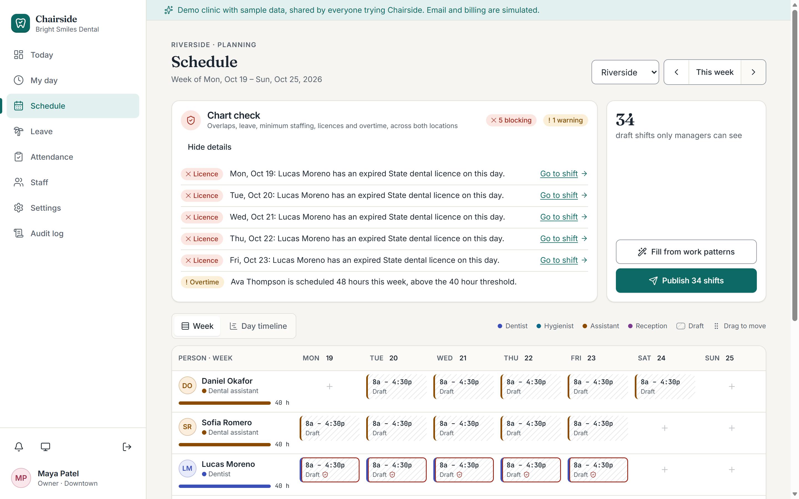
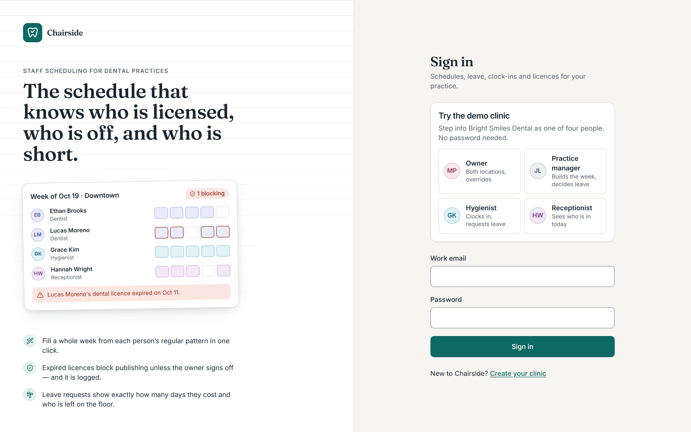
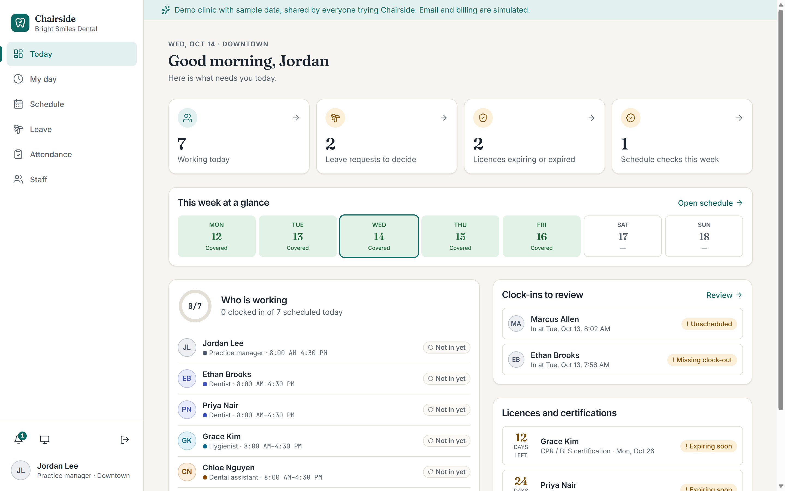
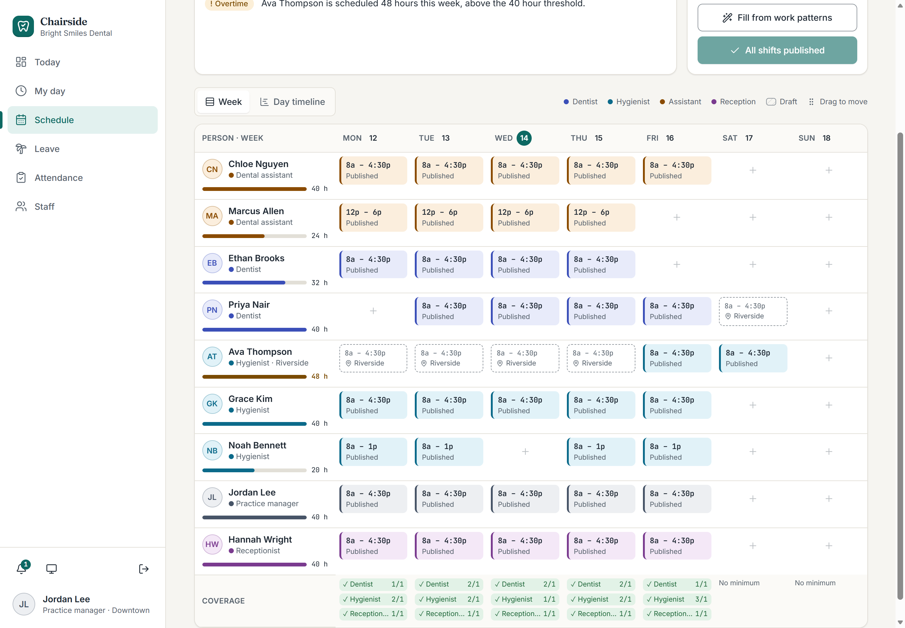
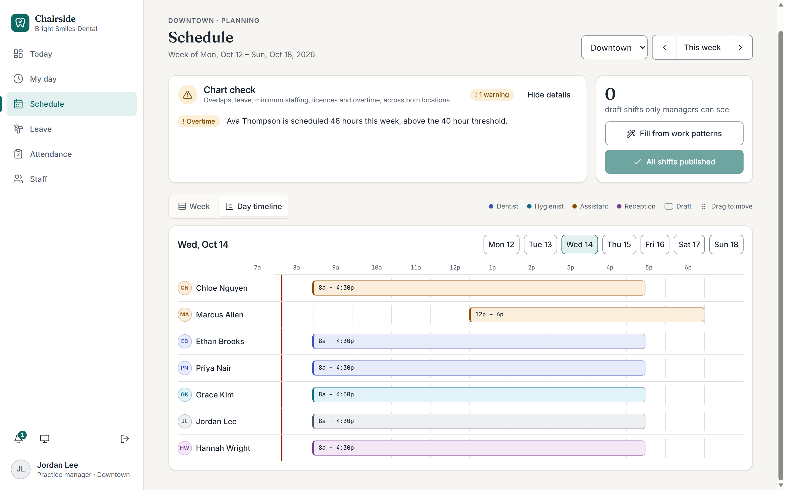
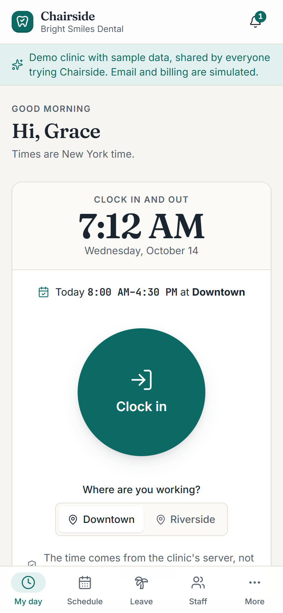
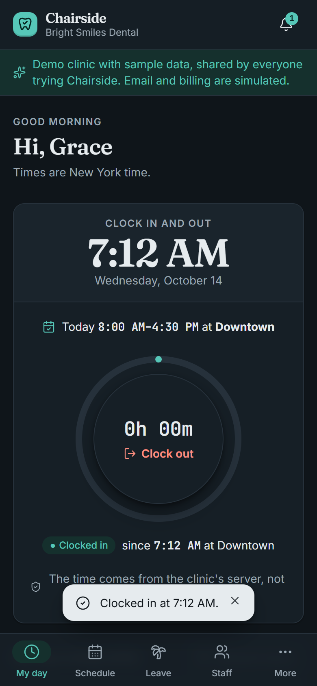
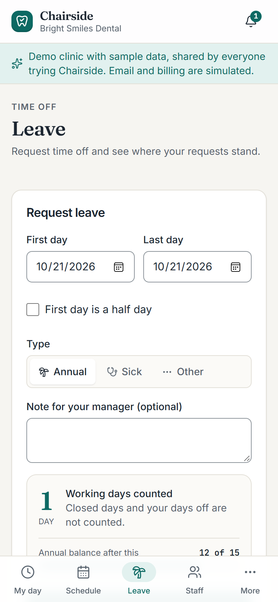
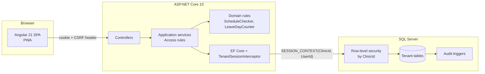

# Chairside

**The staff schedule that knows who is licensed, who is off, and who is short.**

Chairside is a multi-clinic SaaS for dental practices with one to three locations. It replaces paper rosters, spreadsheets and WhatsApp leave requests with one place to build the week, approve leave, clock in from a phone, and keep every licence current. It checks each schedule before it is published and blocks the one problem that is a legal risk: someone working on an expired licence.

Built with **ASP.NET Core 10**, **SQL Server**, and **Angular 21**.



---

## Contents

- [Why Chairside](#why-chairside)
- [Screenshots](#screenshots)
- [Features](#features)
- [Roles and permissions](#roles-and-permissions)
- [Tech stack](#tech-stack)
- [Architecture](#architecture)
- [Security and multi-tenancy](#security-and-multi-tenancy)
- [Design system](#design-system)
- [Getting started](#getting-started)
- [Testing and quality](#testing-and-quality)
- [Project structure](#project-structure)
- [API overview](#api-overview)
- [Roadmap and known limitations](#roadmap-and-known-limitations)
- [Documentation](#documentation)

---

## Why Chairside

General shift tools track licences, but they do not stop you publishing a schedule with an expired one. Practice-management software is built around patients, so staff scheduling is an afterthought. Chairside is staff-only (no patient data, so no HIPAA burden) and understands how a dental office actually runs:

| What goes wrong in a dental office | What Chairside does |
|---|---|
| Two locations, people double-booked across them | Overlap check across **both** locations before publishing |
| Short-staffed days nobody noticed | Minimum headcount per job title, location and weekday, with a coverage row on the schedule |
| A dentist works on an expired licence | Required licences **block publishing** until the owner overrides with a logged reason |
| Overtime surprises | Weekly hours added up across both locations, warned above the threshold |
| Leave requests lost in chat | Requests show exactly how many working days they cost and who is left on the floor |
| "Did she clock out yesterday?" | Server-clock attendance, missed clock-outs flagged, corrections logged |

---

## Screenshots

| Sign in with a live product preview | Practice manager's day |
|---|---|
|  |  |

| Week view: job colours, hours per person, coverage | Day timeline with a "now" line |
|---|---|
|  |  |

| Clock in (phone, light) | Clocked in (phone, dark) | Leave with live day count |
|---|---|---|
|  |  |  |

---

## Features

**Scheduling**
- Weekly grid per location with job-coloured shifts, hours per person and a coverage row.
- **Fill from work patterns**: one click builds the week's drafts from each person's regular pattern, skipping closed days and approved leave.
- **Live chart check** after every edit: overlap or leave, minimum staffing, expired required licence, overtime. "Go to shift" jumps to the problem.
- **Drag a shift** to another day or person (with Undo); the edit dialog does the same by keyboard.
- **Day timeline** (7 AM–7 PM) to see overlaps and gaps at a glance.
- Drafts are only visible to managers; **publish** notifies staff. Licence blocks need an owner override with a reason, which is audited.
- Delete with **Undo** instead of a confirm dialog.

**Leave**
- Request annual, sick or other leave, including half days.
- Days are counted from the person's published shifts or work pattern, never on closed days (US federal holidays are prefilled).
- Live preview of days counted and the balance left; yearly allowance from the clinic policy.
- Managers see **staffing impact** ("Wed, Nov 25: 0 of 1 hygienist left") and overlapping leave before deciding.
- The sole owner's own leave is recorded as approved; a manager's leave goes to the owner.

**Attendance**
- Phone-first clock in and out with a live clinic clock, a large round button and a shift-progress ring. The time comes from the database clock, not the device.
- Clock-ins without a shift are recorded and flagged for the manager to confirm; missed clock-outs are flagged.
- Managers correct records with a required note; unpaid breaks are deducted by default and can be corrected. Weekly overtime is flagged.

**Staff and credentials**
- Directory with search, job colours and licence status.
- Profiles with work pattern (versioned, so past leave counts never change), credentials with expiry status, invitations by link, deactivation that keeps history.

**Clinic administration (owner)**
- Policies: time zone, workweek start, overtime threshold, default break, leave allowance.
- Minimum staffing grid, closed days, locations.
- Plans and billing (**simulated**; location limits are enforced for real), data export as JSON, and an audit log with before/after diffs.

**Everywhere**
- In-app notifications (email is simulated in the prototype), light and dark themes, installable PWA, phone tab bar with bottom sheets.

---

## Roles and permissions

Four roles; the job title decides the role.

| Action | Owner / Admin | Practice Manager | Clinical staff | Reception |
|---|---|---|---|---|
| Build and publish schedules | Both locations | Own location (staff from either) | — | — |
| Override a licence block | ✓ | — | — | — |
| Decide leave | Everyone else | Own location, not own leave | — | — |
| Correct attendance | Both locations | Own location, not own records | — | — |
| View schedule | Both locations | Both (edit own) | Own location, published | Own location, published |
| Clock in, request leave, see own data | ✓ | ✓ | ✓ | ✓ |
| Settings, billing, audit log | ✓ | — | — | — |

Rules are enforced in the API on every endpoint; tenant isolation is enforced again by the database.

---

## Tech stack

| Layer | Choice | Why |
|---|---|---|
| API | ASP.NET Core 10 (controllers), Clean Architecture | Domain → Application → Infrastructure → Api, rules unit-tested in isolation |
| Database | SQL Server 2022 / Azure SQL | Row-level security, triggers and temporal tables are built in |
| Schema | DbUp versioned SQL scripts | The schema, security policy and audit triggers are owned in SQL, reviewed like code |
| Data access | EF Core 10 | CRUD and projections; schedule checks are pure C# over one week of data |
| Auth | Cookie auth + ASP.NET Identity `PasswordHasher` (PBKDF2) | HttpOnly, SameSite=Strict, re-validated each request |
| Web | Angular 21 (standalone, signals, zoneless, OnPush) | Typed, structured SPA; every page lazy-loaded |
| Styling | Tailwind CSS 4 with design tokens | Light and dark themes from one token set |
| Icons / fonts | Lucide; Inter, Fraunces, JetBrains Mono (self-hosted) | One icon set; no third-party requests |
| Tests | xUnit, Vitest, Node end-to-end API suite, axe-core, Lighthouse | Logic, API behaviour, accessibility and performance |

Deliberately not used: MediatR and AutoMapper (now commercially licensed and unnecessary at this size).

---

## Architecture



- **Domain** holds the business rules as pure functions: the four schedule checks, leave day counting, the clinic calendar and US federal holidays.
- **Application** holds the use cases (schedule, leave, attendance, staff, clinic, dashboard) and the role/location rules.
- **Infrastructure** holds EF Core, the tenant interceptor, password hashing, simulated email, analytics logging and the demo seeder.
- **Api** is thin controllers, cookie auth, rate limiting, the CSRF header check and error mapping to RFC 9457 ProblemDetails.

---

## Security and multi-tenancy

- **Tenant isolation in the database.** Every tenant table carries `ClinicId`. A SQL Server security policy filters and blocks rows by `SESSION_CONTEXT('ClinicId')`, which the API sets read-only on every connection. A query that forgets a filter still cannot read or write another clinic.
- **Audit log written by triggers** on 16 tables (schedules, leave, attendance, staff, work patterns, job titles, shift types, credentials, invitations, policies, overrides), with the user taken from the session context. Token hashes and password hashes are never copied into it.
- **Sessions**: HttpOnly, SameSite=Strict cookies (`__Host-` prefixed over HTTPS), re-validated against the database on each request. Each account has a security stamp: signing out, or being deactivated, ends every session on every device, including copied cookies.
- **Invitations** create a first account only, for the address they were sent to. A newer link revokes older ones, a changed address makes the link useless, an existing account can never be taken over, and links are never written to logs.
- **Passwords**: 10–128 characters, common passwords and the email address refused (PBKDF2 hashing). Five wrong passwords lock that account for 15 minutes, on top of the per-IP rate limit.
- **Strict input validation** on the server: plain `name@domain.tld` emails only (no display names, quotes or header tricks), no control or right-to-left override characters in names, dates limited to 2000–2100, enums and cross-references checked.
- **Integrity under concurrency**: unique indexes (one shift per person, day and location; one override per shift and credential; one closed day per date) and SQL application locks around clock-in, "Fill week", publish, leave requests and decisions, and invitation acceptance, so double clicks and two managers at once cannot double-count.
- **Browser hardening**: Content-Security-Policy (scripts only from the site, no framing), Permissions-Policy, X-Content-Type-Options, Referrer-Policy, Cross-Origin-Opener-Policy, HSTS when HTTPS is on.
- **Demo protection**: in the shared demo clinic, invitations, plan and location changes, and deactivating or re-roling the sign-in personas are turned off, so one visitor cannot break the demo for others.
- **CSRF**: every state-changing request must carry a custom header that browsers cannot send cross-site.
- **Rate limiting** on sign-in, sign-up and invitation endpoints.
- **Clock times from the database clock**, never the device.
- **No secrets in responses**: invitation tokens are stored as SHA-256 hashes; exports never include password hashes; model-binding errors never expose .NET type names.
- **No patient data, SSNs or bank details** are stored.

---

## Design system

**Metaphor: the operatory chart** — the calm, ruled paper of a dental chart. 1px rules, readings in tabular monospace, and charting notation for every status (✓ Valid, ◐ Pending, ! Expiring, ✕ Expired), never colour alone. Page titles use a soft editorial serif.

- **Colour**: one accent (sterile teal) for primary actions and selection; dark theme tuned separately, not inverted; a colour per job title, always shown with its text. Every text pair is ≥ 4.5:1 and every UI edge ≥ 3:1, checked with a script.
- **Type**: Fraunces (titles, big numbers), Inter (interface), JetBrains Mono (times and counts).
- **Motion**: 150–420 ms with one ease-out curve; everything collapses under `prefers-reduced-motion`.
- **Components**: logo, avatar, buttons, fields with linked errors, segmented control, badges, alerts, scrollable tables, sheets (bottom sheets on phones) with focus restore, toasts with Undo, skeletons.

Details: [`docs/PRODUCT-SPEC.md`](docs/PRODUCT-SPEC.md#4-design-system) and [`design/design-rules.md`](design/design-rules.md).

---

## Getting started

### Prerequisites

- .NET 10 SDK
- Node.js 22
- SQL Server 2019 or later (Developer or Express edition is fine; Windows authentication by default)

The connection strings point at `localhost\MSSQLSERVER01`. Change `Server=` in
`src/DentalStaff.Api/appsettings.Development.json` and `database/DentalStaff.DbMigrator/appsettings.json` for your instance.

### Run

```bash
dotnet run --project database/DentalStaff.DbMigrator
```

```bash
dotnet run --project src/DentalStaff.Api --launch-profile http
```

```bash
cd web && npx npm@11 install && npx ng serve
```

Open **http://localhost:4200**.

- The migrator creates the `DentalStaff_Dev` database with all tables, row-level security and audit triggers.
- In Development the API seeds the demo clinic **Bright Smiles Dental** (2 locations, 16 people, three weeks of shifts, an expired and two expiring licences, pending leave, a missed clock-out and an unscheduled clock-in).
- On the sign-in page choose a demo role — **Owner**, **Practice manager**, **Hygienist** or **Receptionist** — no password needed. Or create your own clinic with **Create your clinic**.
- Use `npx npm@11 install`: npm 10.9.2 fails on this project with an `edgesOut` error.

### Looking at the data in SSMS

Connect to `localhost\MSSQLSERVER01` with **Trust server certificate** ticked. Because of row-level security, tables look empty until you set the tenant:

```sql
USE DentalStaff_Dev;
EXEC sp_set_session_context N'ClinicId', '6D3F8F0E-1B7A-4C51-9A55-0D3C0DE11C01';  -- demo clinic
SELECT * FROM app.Staff;
```

### Configuration

| Key | Default | Purpose |
|---|---|---|
| `ConnectionStrings:DentalStaff` | local instance | SQL Server connection |
| `Demo:Enabled` | `true` in Development | Seeds the demo clinic and enables demo sign-in |
| `RateLimit:AuthPerMinute` | `10` (`30` in Development) | Sign-in attempts per minute per IP |

---

## Testing and quality

```bash
dotnet test
```

```bash
cd web && npx ng test --watch=false
```

End-to-end API suite (roles matrix, every feature, tenant isolation, malformed input, security). Run it against a freshly seeded database with the API running; it changes the demo data, so reset the database afterwards (drop `DentalStaff_Dev`, run the migrator, restart the API):

```bash
node tests/e2e/api-smoke.mjs
```

**Latest results** (all verified by running them):

| Check | Result |
|---|---|
| Backend unit tests (xUnit) | 53 / 53 |
| Frontend unit tests (Vitest) | 4 / 4 |
| End-to-end API suite (incl. invitation takeover, session revocation, lockout, DST, concurrency rules) | 212 / 212 |
| Scripted browser journeys | 29 / 29 |
| axe-core, WCAG 2.2 A/AA, 12 routes × light/dark × desktop/phone | 0 violations |
| Lighthouse Accessibility / Best Practices | 100 / 100 |
| Lighthouse Performance, production build | Desktop 99–100 · Mobile (slow 4G) 88–94 |
| No sideways scroll at 320 px | All routes |
| Build warnings | 0 |

---

## Project structure

```
DentalStaff/
├─ database/DentalStaff.DbMigrator/   DbUp runner and Scripts/0001–0005 (schema, RLS, audit triggers)
├─ src/
│  ├─ DentalStaff.Domain/             Entities and Rules/ (ScheduleChecker, LeaveDayCounter, ClinicCalendar)
│  ├─ DentalStaff.Application/        Features/ (use cases) and Common/ (access rules, errors, abstractions)
│  ├─ DentalStaff.Infrastructure/     EF Core, tenant interceptor, demo seeder, services
│  └─ DentalStaff.Api/                Controllers, auth, middleware
├─ tests/
│  ├─ DentalStaff.Tests/              xUnit tests for the domain rules
│  └─ e2e/api-smoke.mjs               End-to-end API suite
├─ web/                               Angular app
│  └─ src/app/
│     ├─ core/                        API client, session, formatting, toasts
│     ├─ shared/                      UI kit, icons, brand, scroll regions
│     ├─ layout/                      App shell (sidebar, phone tab bar)
│     └─ features/                    Pages: auth, today, my-day, schedule, leave, attendance, staff, settings, audit
├─ design/design-rules.md
└─ docs/                              Product spec, decisions, original brief, screenshots
```

---

## API overview

All endpoints are under `/api` and need a signed-in user unless marked public.

| Area | Endpoints |
|---|---|
| Auth | `POST signup` `login` `invite` `demo` (public) · `POST logout` · `GET me` · `GET session` (public) · `GET config` (public) |
| Clinic | `GET lookups` `settings` `billing` `coverage/{loc}` `closed-days` `export` · `PUT settings` `coverage` · `POST locations` `billing/plan` `closed-days` · `DELETE closed-days/{id}` |
| Staff | `GET /staff` `/staff/{id}` · `POST /staff` `{id}/deactivate` `{id}/reactivate` `{id}/invite` `{id}/credentials` · `PUT /staff/{id}` · `DELETE {id}/credentials/{cid}` |
| Schedule | `GET /schedule` `/schedule/mine` · `POST shifts` `publish` `fill` · `PUT` / `DELETE shifts/{id}` |
| Leave | `GET mine` `inbox` `team` · `POST /leave` `preview` `{id}/decide` |
| Attendance | `GET me` `/attendance` · `POST clock-in` `clock-out` `{id}/confirm` · `PUT {id}` |
| Overview | `GET dashboard` `notifications` `audit` · `POST notifications/read` |

Errors are RFC 9457 ProblemDetails; validation errors carry an `errors` object keyed by field.

---

## Roadmap and known limitations

**Next milestones**
1. **Pay and hours** — pay records with history and their own row-level security; hours reports (scheduled, worked, breaks, paid, overtime); CSV export.
2. **Real delivery** — email provider, 30-day licence reminders and a nightly missed-clock-out digest, web push, Stripe billing.
3. **Production hardening** — Azure deployment in a US region, Playwright end-to-end suite in CI, per-visitor demo sandbox, account deletion, admin console.

**Known limitations**
- Email, billing and push notifications are simulated.
- No self-service "forgot password" yet (needs real email); the sign-in page tells people to ask their Owner / Admin.
- The per-account sign-in lockout is held in memory, so it resets when the site restarts; a multi-server deployment should move it to the database or a cache.
- Pay and compensation, hours reports and reminder jobs are not built yet.
- The demo clinic is shared by everyone using a deployment.
- Mobile LCP on Lighthouse's slow-4G profile is 2.8–3.0 s (target 2.5 s); desktop is 0.6–0.7 s.
- No usability testing with real practice managers yet; no full screen-reader walk-through.

---

## Documentation

- [`docs/PRODUCT-SPEC.md`](docs/PRODUCT-SPEC.md) — strategy, design system, technical blueprint, delivery report, go-to-market and roadmap
- [`docs/decisions.md`](docs/decisions.md) — decisions that extend or override the original brief
- [`docs/product-brief-and-feature-list.pdf`](docs/product-brief-and-feature-list.pdf) — the original brief
- [`design/design-rules.md`](design/design-rules.md) — design rules every screen follows
- [`CLAUDE.md`](CLAUDE.md) — working rules for AI-assisted development in this repo

Fonts are under the SIL Open Font License; see [`web/public/fonts/LICENSES.md`](web/public/fonts/LICENSES.md).
